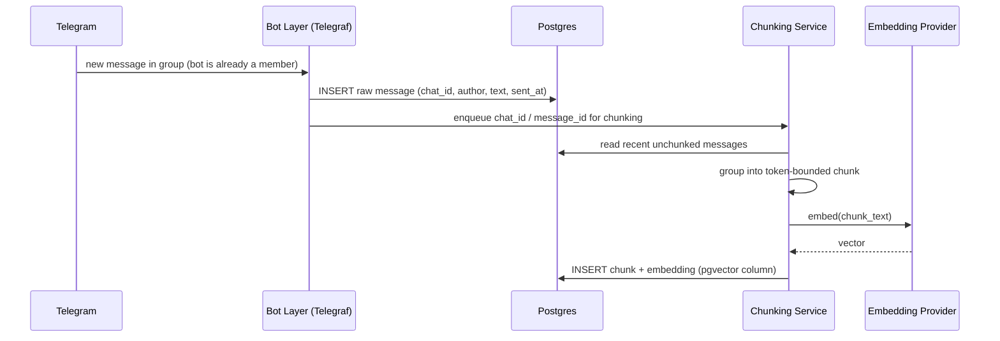
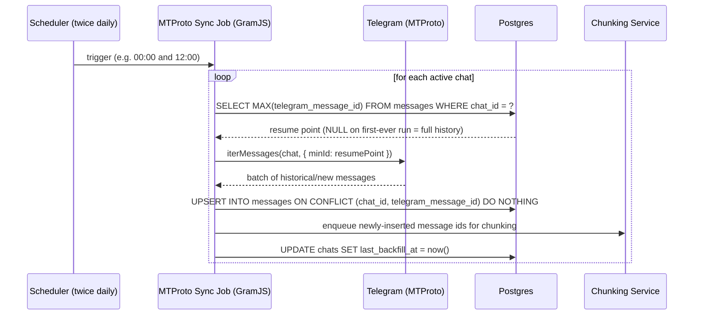
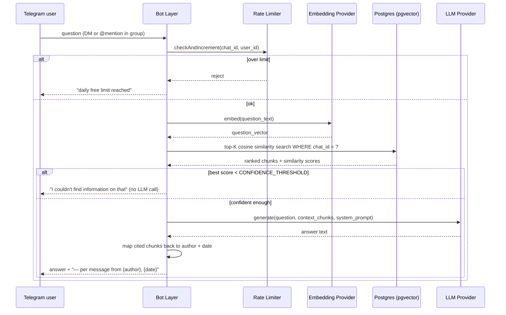

# ARCHITECTURE.md — Telegram KB Bot

Stack constraint: **Node.js/JavaScript only.** Telegraf (or node-telegram-bot-api) for the Telegram layer, Postgres + pgvector for storage and vector search, provider-agnostic adapters for embeddings and LLM generation.

## 1. Components

| Component | Responsibility | Notes |
|---|---|---|
| **Telegram Bot Layer** | Receives real-time updates (messages, commands) via the Bot API, sends replies | Telegraf, webhook in prod / long polling in local dev |
| **MTProto Backfill/Sync Service** | Pulls full chat history (and reconciles it twice a day) via a real Telegram user account | GramJS, scheduled job — see §2a. This is the mechanism that replaces the Bot API's inability to fetch pre-join history |
| **Ingestion Pipeline** | Normalizes inbound messages (from either source above) and persists raw messages, triggers chunking | No consent gate in MVP — see `MVP_SCOPE.md` risk #2. Runs per-message on the hot path for Bot API updates; runs per-batch for MTProto sync |
| **Chunking Service** | Groups raw messages into token-bounded chunks for retrieval | Pure function over stored messages |
| **Embedding Provider Adapter** | Turns text into vectors | **Not the same provider as the LLM** — see §4 note. MVP default: Voyage AI (`voyage-4-lite`) — see `MVP_SCOPE.md` §Embedding provider decision |
| **Vector Store** | Postgres + pgvector, holds chunk embeddings, does top-k similarity search scoped to `chat_id` | See `DATA_MODEL.md` |
| **LLM Provider Adapter** | Generates the final answer from retrieved context | Pluggable: Anthropic Claude / OpenAI / other. Never used for embeddings. |
| **Query/Answer Pipeline** | Orchestrates: question → embed → retrieve → confidence check → prompt → LLM → format reply with citation | See `API_CONTRACTS.md` |
| **Data-Rights Module** | `/forget_chat` full-delete command | Consent/opt-in flow is cut from MVP (see `MVP_SCOPE.md` risk #2); the delete-on-request capability is kept |
| **Rate Limiter / Cost Guard** | Per-chat/per-day question caps, pre-LLM confidence short-circuit | Protects free-tier unit economics |
| **Billing (cut from MVP)** | Plan tier column exists but no real payment integration is built | See `MVP_SCOPE.md` risk #8 |
| **Admin/Landing (optional, low priority)** | Minimal Next.js page to view connected chats / subscription status | Not required for the core loop in §5 of the brief — build last, only if time allows |

## 2. Data flow — real-time message arrives → indexed (Bot API)

No consent gate — every chat the bot is connected to is indexed. See `MVP_SCOPE.md` risk #2 for the accepted trade-off.

## 2a. Data flow — historical backfill + twice-daily sync (MTProto)

The Bot API only ever delivers messages sent *after* the bot joins — it cannot retrieve prior history. A separate scheduled job, authenticated as a real Telegram user account via **MTProto (GramJS)**, fills that gap and doubles as ongoing reconciliation.

Because the same `runMtprotoSync` function handles both "first-ever full backfill" (no resume point) and "ongoing twice-daily reconciliation" (resume point = last known message id), there is no separate backfill code path to maintain — see `API_CONTRACTS.md` §2a.

The Bot API listener (§2) still handles real-time messages between sync runs — MTProto is not needed for live updates, only for filling in history the bot wasn't present for and catching anything the bot missed (e.g. downtime).

## 3. Data flow — user asks a question → answer with citation

## 4. Provider-agnostic adapters — important note

The brief describes "an LLM API for embeddings and answer generation" as if it's one thing. **It generally isn't for Claude specifically**: Anthropic's Messages API does not expose a text-embeddings endpoint. The architecture therefore defines **two independent adapter interfaces**, each swappable via env var, so the wiring is correct regardless of which providers get plugged in later:

- `EmbeddingProvider` — e.g. Voyage AI, OpenAI (`text-embedding-3-*`), Cohere
- `LLMProvider` — e.g. Anthropic Claude, OpenAI, others

These are never assumed to be the same vendor. See `API_CONTRACTS.md` §1 for the interfaces and `ENV_SETUP.md` for the env vars that select each.

## 5. Deployment shape (MVP)

- Single Node.js process: Telegram bot (webhook endpoint or polling loop) + query pipeline + `node-cron` scheduler for the MTProto sync job, sharing one Postgres pool.
- Chunking/embedding can run inline in-process for MVP scale (5000+ messages is small); revisit a job queue (BullMQ/pg-boss) only if latency or backfill volume demands it.
- Postgres is the only stateful dependency — pgvector lives in the same instance, no separate vector DB service.
- The MTProto session (a real Telegram user account's login) is a separate, sensitive credential from the bot token — see `ENV_SETUP.md` and `MVP_SCOPE.md` risk #1 for its operational and security implications.
